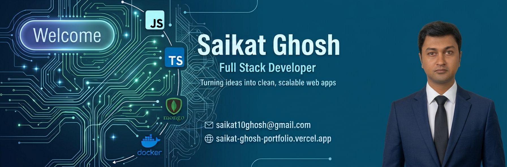

<div align="center">


<br/>

<table>
<tr>
<td align="center">

<br/>


<h1 align="center"> SAIKAT GHOSH </h1>


<br/>



<br/><br/>

<sub>🚀 Building fast &nbsp;•&nbsp; 🎨 Designing clean &nbsp;•&nbsp; 💡 Shipping smart</sub>

<br/><br/>

</td>
</tr>
</table>

<br/>


</div>

---

## 🧠 &nbsp;About Me

<table>
<tr>
<td width="60%" valign="top">

Frontend Developer from **Bangladesh 🇧🇩** focused on building **fast, scalable and visually clean** web applications using the modern JavaScript ecosystem.

```js
const saikat = {
  role: "Frontend Developer",
  stack: ["React", "Next.js", "TypeScript", "Tailwind"],
  state: "Redux Toolkit",
  backendAwareness: ["Node.js", "Express", "Laravel"],
  databases: ["MongoDB", "MySQL", "Firebase"],
  mindset: "Ship fast. Keep it clean. Make it feel good.",
};
```

</td>
<td width="40%" valign="top" align="center">


<br/>

**Saikat Ghosh**

*UI-Focused Frontend Engineer*

</td>
</tr>
</table>

---

## ⚡ &nbsp;What I Build

<div align="center">

| 🛒 **E-Commerce** | 📊 **Dashboards** | 📱 **Responsive Apps** |
|:---:|:---:|:---:|
| Storefront + Admin UI | Analytics & control panels | Mobile-first experiences |
| 🔗 **API-Driven Apps** | 🎯 **Component Systems** | 💼 **Business Sites** |
| Dynamic data-rich UIs | Scalable, reusable architecture | Portfolio & company websites |

</div>

---

## 🛠️ &nbsp;Tech Arsenal

<div align="center">

**⚡ Core Frontend**


**🎨 UI Engineering**


**⚙️ Backend Awareness**


**🗄️ Databases**


**🧰 Tools & Deployment**


</div>

---

## 📊 &nbsp;GitHub Stats

<div align="center">


</div>

---

## 📈 &nbsp;Currently Leveling Up

<div align="center">


</div>

---

## 💼 &nbsp;Featured Projects

<div align="center">

| Project | Description | Stack |
|:---|:---|:---|
| 🛒 **E-Commerce Platform** | Full storefront with Admin Panel | `React` `Redux` `Tailwind` |
| 🏥 **Healthcare Management** | Patient & appointment system | `React` `API` `Tailwind` |
| ✈️ **Travel Booking UI** | Modern booking experience | `Next.js` `TypeScript` |
| 💼 **Business Websites** | Portfolio & company sites | `Next.js` `Tailwind` |
| 👨‍💻 **Personal Portfolio** | My developer showcase | `Next.js` `Vercel` |

<br/>

<a href="https://saikat-ghosh-portfolio.vercel.app/">

</a>

</div>

---

## 📬 &nbsp;Let's Connect

<div align="center">

<a href="mailto:saikat.blast20@gmail.com">

</a>
<a href="https://github.com/saikatghosh3">

</a>
<a href="https://saikat-ghosh-portfolio.vercel.app/">

</a>

</div>

---

<div align="center">

### 💡 Developer Mindset

*"I don't just build UI — I build experiences that feel fast, clean, and intuitive."*

<br/>


</div>
